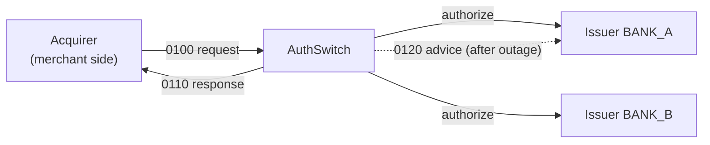
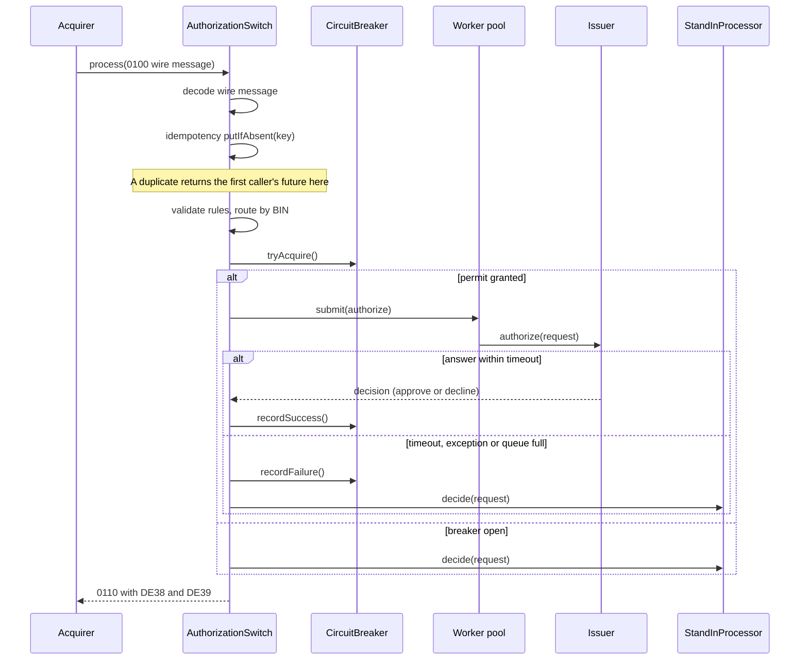
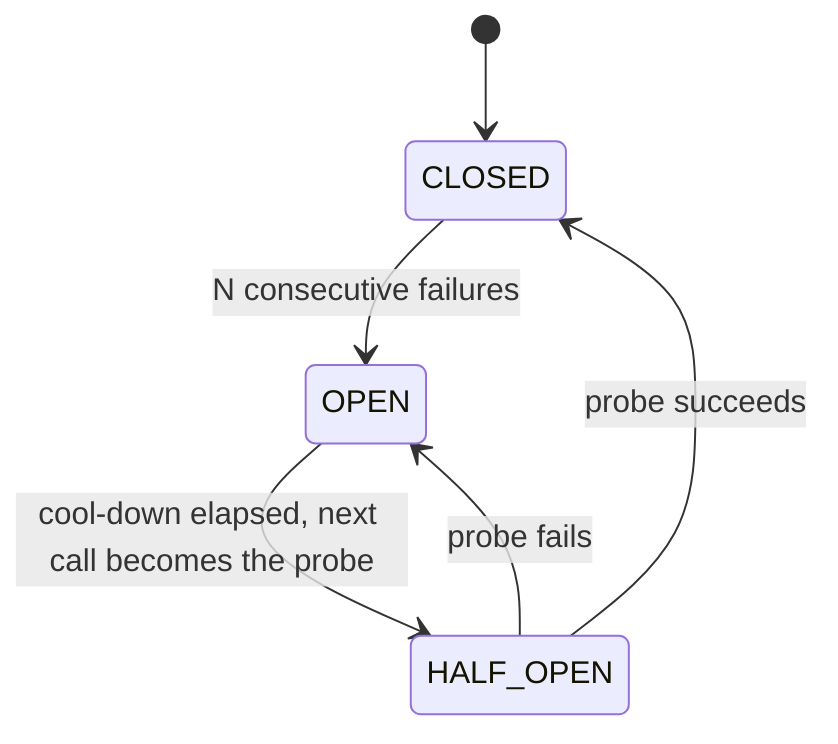

# AuthSwitch architecture

This document explains how AuthSwitch is built and why. It assumes you have skimmed the
[README](../README.md). Class and method names are real, so you can follow along in the code.

**Contents:**
[1 Context](#1-context-and-scope) ·
[2 Goals](#2-design-goals) ·
[3 Components](#3-component-map) ·
[4 Lifecycle](#4-request-lifecycle) ·
[5 Resilience](#5-resilience-circuit-breaker-and-stand-in) ·
[6 Concurrency](#6-concurrency-model) ·
[7 Decisions](#7-key-design-decisions) ·
[8 Testing and security](#8-testing-and-security) ·
[9 Limitations](#9-known-limitations-and-production-gaps) ·
[10 Conventions](#10-code-conventions-and-extension-points) ·
[11 References](#11-references)

---

## 1. Context and scope

In a card payment, the merchant's **acquirer** sends an authorization request to the card network, and the
network forwards it to the cardholder's bank, the **issuer**. AuthSwitch plays the network's role.



**In scope:** decoding and validating ISO 8583 authorizations, routing by BIN, timeouts, circuit breaking,
stand-in approval, idempotent retries, advice replay, metrics and audit.

**Out of scope:** clearing and settlement, reversals (0400), PIN/MAC/EMV processing, persistence, and real
network transports. See [section 9](#9-known-limitations-and-production-gaps).

## 2. Design goals

In priority order. When two goals conflict, the earlier one wins.

1. **Always answer.** Every request gets a 0110 within a bounded time, even if the issuer is down.
2. **Never double-process.** A retransmitted message must not reach the issuer twice.
3. **Contain failure.** One slow issuer must not degrade traffic to another.
4. **Bound resources.** Threads and queues have fixed sizes; overload is shed, not buffered forever.
5. **Never leak card data.** The raw PAN must not appear in logs, events or `toString` output.
6. **Stay testable.** Time is injected, so state transitions are tested without sleeping.

## 3. Component map

| Package | Key types | Responsibility | Pattern |
|---|---|---|---|
| `iso` | `Iso8583Codec`, `Iso8583Message` | Wire format: MTI, bitmap, fixed and LLVAR fields, strict length and charset checks | Builder (immutable message) |
| `model` | `AuthRequest`, `ResponseCode`, `IssuerDecision`, `PanUtil` | Typed request, DE39 codes, Luhn check, PAN masking | Records / value objects |
| `validation` | `ValidationHandler`, `Validators` | Business rules in a fixed order: processing code, Luhn, amount, expiry | Chain of Responsibility |
| `routing` | `BinRouter`, `Route` | BIN to issuer in O(log n); rejects overlapping ranges at build time | Immutable lookup table |
| `issuer` | `Issuer`, `SimulatedIssuer` | The thing being protected; simulated with latency and failure injection | Strategy |
| `resilience` | `CircuitBreaker` | Per-issuer failure tracking with a single half-open probe | State machine |
| `standin` | `StandInProcessor` | Approve small amounts when the issuer is unreachable; queue and replay advices | Atomic counters |
| `observer` | `TransactionListener`, `MetricsCollector`, `AuditLogger` | Metrics and audit, isolated from the hot path | Observer |
| `core` | `AuthorizationSwitch` | Orchestrates everything above; owns thread pools and the idempotency store | Builder, Facade |
| `demo` | `Demo`, `ApiServer` | Console scenario and HTTP API for the web page | n/a |

**Dependency direction:** `core` depends on everything else; `iso`, `model`, `resilience`, `routing`,
`standin`, `validation` and `observer` do not depend on `core`. `Route` is the only type that joins a router
entry to a breaker, which is what makes the breaker per-issuer.

## 4. Request lifecycle



### Where each answer comes from

Every transaction ends on exactly one **path**, recorded in `TransactionEvent.Path` and counted by
`MetricsCollector`.

| Path | Trigger | DE39 |
|---|---|---|
| `FORMAT_ERROR` | Wire message fails decoding, or a mandatory field is missing | `30` |
| `VALIDATION` | A rule in the chain rejects the request | `12` processing code, `14` Luhn, `13` amount, `54` expired, `30` bad expiry month |
| `NO_ROUTE` | No BIN range matches | `15` |
| `ISSUER` | Issuer answered in time | Whatever the issuer decided (`00`, `51`, ...) |
| `STAND_IN` | Breaker open, issuer failed or timed out, or pool saturated | `00` within limits, otherwise `91` |
| `ISSUER` with issuer `-` | Unexpected internal exception | `96` |

The order inside `process` and `run` is: decode, idempotency check, validation, BIN routing, breaker. The
idempotency entry is created **before** validation, so a retried invalid request gets the same stored rejection
without re-running the chain. Validation and routing both happen before any issuer work is queued, so a
malformed or unroutable request never consumes issuer capacity.

## 5. Resilience: circuit breaker and stand-in

### Circuit breaker



- **What counts as a failure:** timeout, exception from the issuer, or the worker pool rejecting the task.
- **What does not:** a decline. Insufficient funds (`51`) proves the issuer is up, so it calls `recordSuccess()`.
- **Half-open admits exactly one probe.** Others are turned away and go to stand-in. `probeInFlight` is cleared
  by either `recordSuccess` or `recordFailure`. This is why a pool rejection must call `recordFailure()`:
  otherwise a rejected probe would leave the breaker stuck, waiting for a result that never comes.
- **Transition callback:** when the breaker returns to `CLOSED`, the switch schedules `StandInProcessor.replay`
  on the housekeeping pool. Callbacks from `recordSuccess` and `recordFailure` fire outside the breaker's lock.
  The `OPEN` to `HALF_OPEN` callback fires from `tryAcquire` while the lock is held, so callbacks must never call
  back into the same breaker.

### Stand-in processing (STIP)

1. Amount above the per-transaction cap: decline `91`.
2. Otherwise, atomically add the amount to that card's exposure with `ConcurrentHashMap.compute`. If the
   cumulative cap would be exceeded, decline `91`.
3. Otherwise approve `00` with a locally generated id (`S00001`, ...) and enqueue an **advice** for the issuer.
4. On breaker close, `replay` drains the queue to `Issuer.advise`. It stops at the first failure and re-queues
   that advice. When the queue is empty, stand-in exposure is reset.

The check and the add are one atomic step, so 100 threads hitting one card can approve at most the cap in
total. A separate read-then-write would let them all pass the check first.

## 6. Concurrency model

### Threads

| Pool | Size | Purpose |
|---|---|---|
| Caller threads | Owned by the caller | Decode, validate, idempotency check, breaker check. Never block on the issuer |
| `issuer-worker` | Default 32 workers, queue 256, `AbortPolicy` | Blocking issuer calls. A full queue throws, which becomes stand-in |
| `housekeeping` | 2 daemon threads | Purge expired idempotency entries; run advice replay |

`process` returns a `CompletableFuture<String>` so callers can wait or compose. The issuer call is bridged
with `orTimeout`; on a timeout the worker is interrupted via `Future.cancel(true)`, and `SimulatedIssuer`
restores the interrupt flag and exits.

### Shared state and what protects it

| State | Structure | Protection | Invariant |
|---|---|---|---|
| Idempotency store | `ConcurrentHashMap<String, Entry>` | `putIfAbsent` | One winner per key; everyone else shares its future |
| Circuit breaker fields | Plain fields | `synchronized` methods | State, failure count and probe flag change together |
| Stand-in exposure | `ConcurrentHashMap<String, Long>` | `compute` | Per-card total never exceeds the cap |
| Advice queues | `ConcurrentLinkedQueue` per issuer | Lock-free queue | No advice is lost; failed replays are re-queued |
| Issuer balance | `AtomicLong` per card | CAS loop | Balance never goes negative from concurrent debits |
| Metrics | `LongAdder`, `LongAccumulator` | Striped cells | No contention on the hot path |
| Listeners | `CopyOnWriteArrayList` | Copy on write | Safe iteration while listeners are added |
| `BinRouter` | `TreeMap` built once | Immutability after construction | Lookups need no lock |

## 7. Key design decisions

Each entry gives the decision, the reasoning, and what it costs.

**D1. A decline is a healthy answer.**
The breaker measures *reachability*, not *business outcome*. If declines counted as failures, a run of
insufficient-funds responses would trip the breaker and route healthy traffic to stand-in.
*Cost:* the breaker cannot detect an issuer that is up but wrongly declining everything.

**D2. The future never fails for business or infrastructure errors.**
A switch that throws is a switch that does not answer. Timeouts, open breakers and saturation all end in a
normal 0110. *Cost:* callers cannot distinguish "issuer said no" from "stand-in said no" by exception; they
use DE39 and the audit path instead.

**D3. Idempotency by transmission identity, shared in-flight.**
Key = terminal id + STAN + RRN + transmission time, the fields an acquirer keeps stable on retry. The first
caller stores a future via `putIfAbsent`; later callers get that same future, including while it is in flight.
Completed entries expire after a TTL (default 5 minutes). *Cost:* memory, and the gap noted in
[section 9](#9-known-limitations-and-production-gaps) about differing payloads.

**D4. Bounded pool, reject on overflow, shed to stand-in.**
An unbounded queue turns a slow issuer into an out-of-memory failure and unbounded latency. Rejecting early
keeps latency predictable. *Cost:* during a spike, some requests that a healthy issuer could have answered get
stand-in answers instead.

**D5. Fail fast on an open breaker.**
`tryAcquire()` runs before submitting work, so a known-bad issuer consumes no pool capacity.

**D6. A breaker per issuer (bulkhead).**
The `Route` record pairs each BIN range with its own breaker, so BANK_A's outage cannot open BANK_B's circuit.
The demo's phase 2 demonstrates this.

**D7. Observers cannot affect the result.**
Listener exceptions are caught and ignored in `publish`. Metrics and audit are secondary to the answer.
*Cost:* a broken listener fails silently; production would count listener failures.

**D8. Injected clock, no framework.**
`CircuitBreaker` takes a `LongSupplier` and validators take a `Clock`, so tests control time. Using only the JDK
keeps the project buildable with `javac` alone and makes every moving part visible.

## 8. Testing and security

### Tests

`make test` runs 16 tests with a small built-in runner (no JUnit). They are grouped by the invariant they guard:

| Invariant | Test |
|---|---|
| Wire format is exact | Codec round trip; bitmap bits; truncated, trailing and non-numeric data rejected |
| Rules reject bad input with the right code | Validation chain: Luhn, amount, expiry, processing code |
| BIN ranges never overlap | Router lookup and overlap detection |
| Breaker follows its state machine | Closed to open to half-open to closed with a single probe; a failed probe re-opens |
| Stand-in cap is exact under contention | 100 concurrent threads on one card; per-transaction cap returns `91` |
| Money is never overspent | Concurrent spending against one balance |
| Retries reach the issuer once | Duplicate in-flight requests produce one issuer call |
| The switch degrades instead of failing | Slow issuer times out to stand-in; outage trips the breaker and recovery replays advices; saturated pool sheds load |
| No PAN leaks | Bad-input test checks response codes and that `toString` contains no PAN |

The breaker and validation unit tests use controlled clocks and never sleep. The end-to-end recovery test deliberately uses the real clock (with short waits) because it exercises the real cool-down.

### Data handling

- `PanUtil.mask` keeps only the first 6 and last 4 digits. `TransactionEvent` carries the masked PAN only, so
  observers and logs never see the raw value.
- `Iso8583Message.toString` prints field numbers, not values.
- The HTTP API is simulation-only: it generates its own test cards and accepts no card input. CORS is open
  because the API holds no secrets or real data.
- The Docker image runs as a non-root user.

## 9. Known limitations and production gaps

Listed so a reviewer does not have to find them. None of these are hidden by the tests.

| Gap | Effect today | What production would do |
|---|---|---|
| Idempotency key ignores amount and PAN | A retry reusing a key with a *different* payload receives the first answer | Store a payload fingerprint and reject mismatches with an error |
| In-memory idempotency and advice queues | Lost on restart; not shared across nodes | Durable store; replay advices in order |
| Advices replay only on breaker close | Advices from a one-off timeout (breaker never opened) wait for a later outage | Also drain whenever an issuer call succeeds |
| Advice queue is unbounded | Bounded in practice by per-card caps, but grows during a long outage | Size limits and alerting |
| Stand-in exposure is one global map | When one issuer's queue drains, exposure is reset for all cards | Track exposure per issuer |
| Stand-in limits are static | Same caps for every card | Issuer-supplied limits by BIN and merchant category |
| Replay runs on a 2-thread housekeeping pool | A slow issuer during replay delays purging | Dedicated replay executor with its own timeout |
| Stand-in ids wrap at 100,000 | Ids can repeat in a long run | Include a date or node prefix |
| Encoding failure after a decision | The future completes exceptionally (a should-not-happen path, since response fields are controlled) | Alert on it, and return a static `96` response |
| Simplified ISO 8583 | 11 data elements, ASCII, primary bitmap only | Network-specific binary or EBCDIC codec |

## 10. Code conventions and extension points

### Conventions used throughout

- **Immutable data.** Messages, requests, decisions, events and routes are records or builder-built objects.
- **Names carry units and intent.** `amountMinor`, `issuerTimeoutMs`, `latencyMicros`, `idempotencyKey`,
  `completeViaStandIn`: the name says what the value or step is without a comment.
- **Small, single-purpose classes.** Each validator checks one rule. Orchestration stays in one class, split into
  stage-named private methods (`run`, `dispatch`, `completeViaStandIn`, `complete`).
- **Comments explain why.** For example, why a rejected submission calls `recordFailure()`, or why listener
  exceptions are swallowed.
- **Time and failure are injectable.** Clock and issuer mode are inputs, which is why the tests are fast and
  deterministic.

### Refactors I would do next

- Extract the idempotency store from `AuthorizationSwitch` into its own class with its own tests.
- Introduce a small `TransactionContext` record to replace the repeated `(msg, req, start, out)` parameter group.
- Port `AllTests` to JUnit 5 and add a Gradle or Maven build.

### Adding a validation rule

Write a handler, then add it to `Validators.standardChain`. The switch itself does not change.

```java
public final class CurrencyHandler extends ValidationHandler {
    private static final String INR_NUMERIC_CODE = "356";

    @Override
    protected Optional<ResponseCode> check(AuthRequest request) {
        boolean supported = INR_NUMERIC_CODE.equals(request.currency());
        return supported ? Optional.empty() : Optional.of(ResponseCode.INVALID_TRANSACTION);
    }
}
```

```java
// in Validators.standardChain(...)
.then(new ExpiryHandler(clock))
.then(new CurrencyHandler());
```

### Adding an issuer or a listener

- **Issuer:** implement `Issuer` (`authorize`, `advise`), then register it with
  `AuthorizationSwitch.builder().route(binLow, binHigh, issuer)`. Throw `IssuerException` when unreachable and
  return a decline when reachable.
- **Listener:** implement `TransactionListener.onCompleted` and register it with `.listener(...)`.

## 11. References

Sources behind the design choices, for anyone who wants to check them.

- ISO 8583, the financial transaction card message standard (message types 0100/0110/0120, bitmaps, DE39 codes).
- ISO/IEC 7812-1 and the Luhn algorithm, for PAN structure and check digits.
- Martin Fowler, [CircuitBreaker](https://martinfowler.com/bliki/CircuitBreaker.html), and Michael Nygard,
  *Release It!*, for the circuit breaker and bulkhead patterns.
- Stripe API docs, [Idempotent requests](https://docs.stripe.com/api/idempotent_requests), for the idea that a
  retried request must return the original result.
- Java SE API docs for `CompletableFuture.orTimeout`, `ThreadPoolExecutor.AbortPolicy`,
  `ConcurrentHashMap.compute` and `LongAdder`.
- Brian Goetz et al., *Java Concurrency in Practice*, for the confinement, atomicity and visibility reasoning in
  [section 6](#6-concurrency-model).
